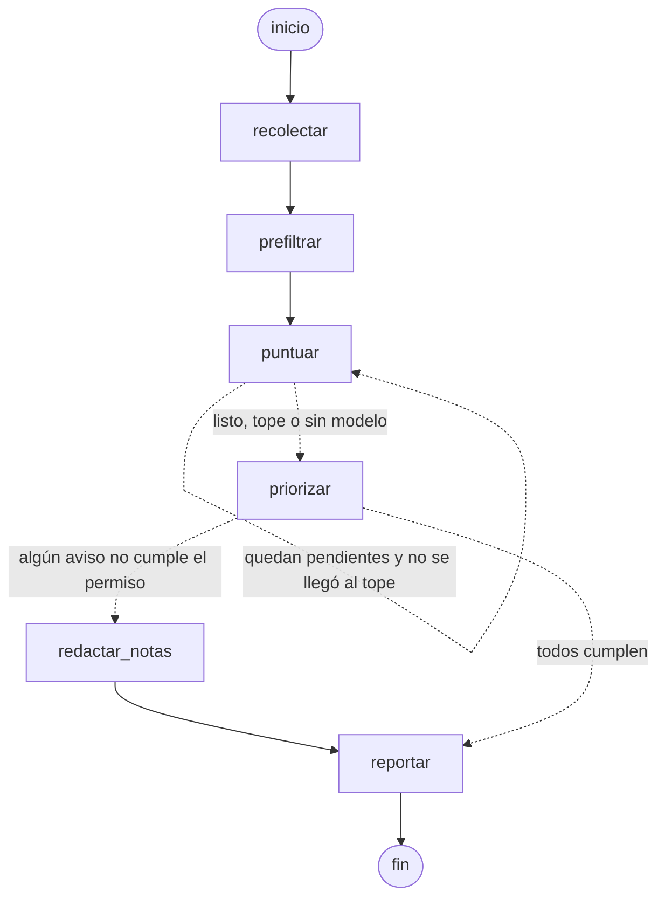

# Agentes con LangChain y LangGraph (piloto: `empleo`)

Los demás agentes son Python simple: `run.py` hace los pasos en orden y `core/llm.py` habla con los modelos.
El agente `empleo` es el **piloto con LangGraph**. Los dos estilos conviven para poder compararlos.

## Qué es cada cosa y qué cuesta

| Pieza | Para qué | Costo |
|---|---|---|
| **LangChain** (`langchain-core`, `langchain-ollama`, `langchain-groq`, `langchain-anthropic`) | Interfaz común para modelos (`ChatOllama`, `ChatGroq`, `ChatAnthropic`), prompts, parsers y respaldo (`.with_fallbacks`) | Gratis, código abierto (MIT) |
| **LangGraph** (`langgraph`, `langgraph-checkpoint-sqlite`) | El flujo como grafo: nodos, condiciones, ciclos y estado guardado (checkpointer) | Gratis, código abierto (MIT) |
| LangSmith | Ver trazas de cada llamada (opcional, servicio web) | Plan gratis con límite mensual; planes pagos. **No se usa aquí** |
| LangGraph Platform | Alojar grafos en su nube | De pago. **No hace falta**: corre en la Mac o el servidor como los demás |

Los modelos se pagan aparte, igual que antes: Ollama y el plan gratis de Groq no cuestan; Claude sí (con tope).

## Qué cambia frente al estilo simple

| | Estilo simple (`freelance`, `fx`...) | LangGraph (`empleo`) |
|---|---|---|
| Modelos | `core/llm.py`: un cliente HTTP por proveedor y bucle de respaldo a mano | `core/llm_lc.py`: `ChatModel` de LangChain + `.with_fallbacks()`; cadena `prompt \| modelo \| parser` |
| Flujo | Funciones llamadas en orden dentro de `main()` | `StateGraph`: un nodo por paso, aristas con condiciones y un ciclo (`puntuar` en lotes) |
| Estado | Variables locales; si la corrida se corta, se pierde | Checkpointer SQLite (`data/empleo_graph.db`): se guarda tras cada nodo y la siguiente corrida **retoma** |
| Pendientes | Lo que no alcanzó a puntuarse se perdía si la API no se volvía a consultar | Quedan en el estado y se puntúan en la próxima corrida |
| Costo de Claude | Se registra dentro de `claude_text()` | Callback `ClaudeCost` (registra en la tabla `costs`) |
| Programación, avisos, config | launchd/systemd, Telegram, `.env` y YAML | **Igual** |

**Cuándo conviene LangGraph:** flujos con ramas, ciclos, pasos largos que pueden cortarse o pausas para que una
persona apruebe (`interrupt()`). Para un agente lineal sin modelo (como `fx`), el estilo simple basta.

## El grafo de `empleo`



| Nodo | Qué hace |
|---|---|
| `recolectar` | Llama a `sources.collect()` (APIs y correos), registra las ya postuladas y deja solo las nuevas |
| `prefiltrar` | Reglas gratis (palabras, exclusiones, país en el título) y suma las pendientes de corridas anteriores |
| `puntuar` | Lote de 10: el modelo **extrae** datos y `scorer.compute_score()` **decide**. Se repite hasta terminar o llegar a `--max-puntuar` |
| `priorizar` | Ordena por encaje con el permiso y elige qué avisar |
| `redactar_notas` | Para avisos que no cumplen el permiso tal cual, el modelo redactor escribe una nota corta para postular |
| `reportar` | Reporte Markdown y avisos por Telegram |

Archivos: `agents/empleo/graph.py` (grafo y estado), `run.py` (checkpointer y retoma), `scorer.py` (reglas),
`report.py` (salidas), `core/llm_lc.py` (modelos), `tests/test_empleo.py` (pruebas).

## Instalar y configurar

```bash
.venv/bin/pip install -r requirements.txt          # incluye langgraph y los conectores de langchain
cp config/empleo.example.yaml config/empleo.yaml    # preferencias (ver abajo)
```

En `.env`, los mismos nombres de siempre (no hay variables nuevas):

```bash
EMPLEO_SCORER_BACKEND=groq      # quién puntúa: ollama | groq | claude
EMPLEO_SCORER_FALLBACK=ollama   # respaldo si el primero falla (with_fallbacks)
WRITER_BACKEND=ollama           # quién redacta las notas para postular
WRITER_FALLBACK=groq
GROQ_API_KEY=...                # si usas groq
```

## Correr y probar

```bash
.venv/bin/python -m agents.empleo.run --solo-fuentes  # prueba las fuentes (no gasta turnos ni avisa)
.venv/bin/python -m agents.empleo.run                 # corrida real (retoma sola si la anterior quedó a medias)
.venv/bin/python -m agents.empleo.run --estado        # ¿corrida a medias? ¿pendientes?
.venv/bin/python -m agents.empleo.run --grafo         # el grafo en Mermaid (pégalo en mermaid.live)
.venv/bin/python -m agents.empleo.run --reiniciar     # descarta lo guardado y empieza de cero
.venv/bin/python -m unittest tests.test_empleo -v     # pruebas: reglas, grafo completo y retoma tras un corte
./scripts/instalar_launchd.sh empleo                  # programarlo (cada 2 h); estado con ./scripts/estado.sh
```

Las pruebas no usan red ni claves: reemplazan el modelo por `FakeListChatModel` de LangChain y las fuentes
por una lista fija. Una de ellas corta la corrida a mitad de `puntuar` y comprueba que la siguiente la retoma
sin volver a consultar las fuentes.

## Replicarlo en otro agente

1. **Estado:** un `TypedDict` con solo datos serializables (dicts, listas, textos). Los objetos (conexión a la
   base, configuración) van en el cierre de los nodos, no en el estado.
2. **Nodos:** funciones `estado → dict con lo que cambia`. Una tarea por nodo.
3. **Aristas:** `add_edge` para lo fijo y `add_conditional_edges(nodo, función_que_elige, [destinos])` para
   ramas y ciclos.
4. **Checkpointer:** `SqliteSaver.from_conn_string("data/<agente>_graph.db")` y un `thread_id` fijo por agente.
   Al empezar, si `app.get_state(cfg).next` no está vacío, `app.invoke(None, cfg)` retoma; si no, borrar el hilo
   (`saver.delete_thread`) para que la base no crezca y empezar con el estado inicial.
5. **Modelos:** `core.llm_lc.chat_model(VAR_BACKEND, defecto, VAR_FALLBACK, conn)` y
   `json_chain(system, modelo)` para respuestas JSON.
6. **Pruebas:** `FakeListChatModel(responses=[...])` en lugar del modelo real.

Patrón útil para lo que viene: `langgraph.types.interrupt()` pausa el grafo hasta recibir una respuesta
(ej. aprobar una propuesta por Telegram) y `Command(resume=...)` lo continúa. `empleo` no lo usa porque
nunca postula.
